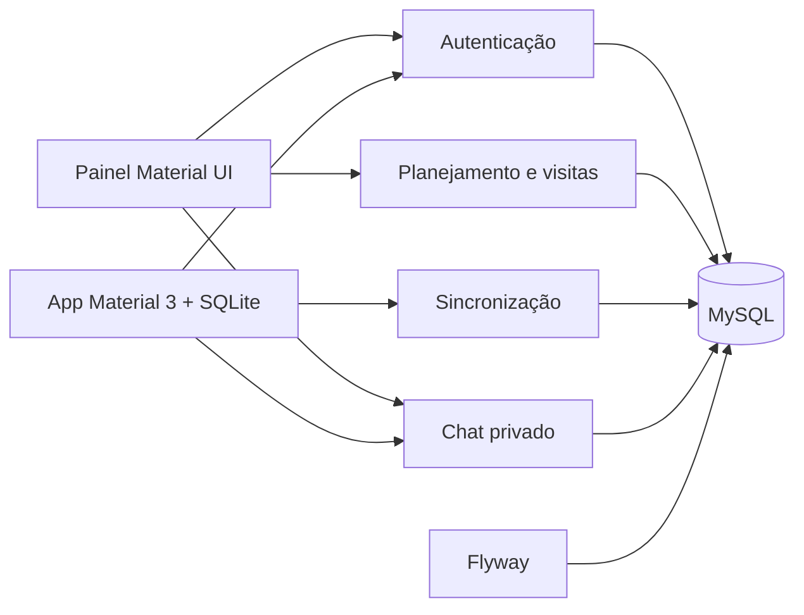

# Arquitetura implementada

As fronteiras dos serviços e os pontos de escala estão detalhados em [ESCALABILIDADE.md](ESCALABILIDADE.md). O envio de email usa outbox durável no serviço de autenticação; o cálculo de rotas tem limite de concorrência; leitura e escrita da sincronização têm serviços separados. O app usa entidades Drizzle, migrações SQLite geradas e TypeScript no código de execução.

Os limites de serviço existentes foram mantidos. O problema encontrado estava nos contratos e na autorização entre eles; não foi necessário introduzir outro serviço de negócio.

## Servidores Java

Controllers tratam o transporte HTTP, serviços executam os casos de uso e classes de persistência encapsulam o SQL. As dependências obrigatórias usam injeção por construtor. Escritas compostas usam transações; erros não são mais ocultados como respostas de sucesso. O tratamento central de exceções mantém os códigos HTTP e evita expor detalhes de SQL ao cliente.

A autenticação usa Spring Security Resource Server e JWT HS256 com emissor fixo, expiração de 30 minutos e chave externa de pelo menos 32 bytes aleatórios em Base64. As claims `uid`, `cede`, `roles` e `ver` são conferidas contra o cadastro ativo. Bloqueio, mudança de sede/papel ou incremento de versão invalidam a autorização. A troca de senha incrementa a versão, revogando tokens já emitidos.

As consultas e escritas de planejamento são limitadas à sede do usuário autenticado. Alterar planejamentos, ordenar rotas e excluir visitas exige administrador. O cadastro público sempre cria agentes pendentes; o papel enviado pelo cliente não é persistido. A aprovação ocorre por REST autenticado, com administrador da mesma sede. O antigo WebSocket de aprovação sem autenticação está desabilitado.

Senhas novas usam BCrypt com custo 12. Hashes SHA-256 existentes só são convertidos após uma verificação bem-sucedida. Novas senhas precisam ter pelo menos 12 caracteres e no máximo 72 bytes. Códigos têm validade de 10 minutos e limite de tentativas; recuperação de senha não informa se uma conta existe. Há limites por IP, limites de corpo de requisição e CORS por origens configuradas.

## Web

O painel tem tema Material UI central, navegação responsiva, componentes acessíveis, estados de carregamento/erro/vazio e divisão de código por rota. O adaptador HTTP central injeta o token somente em origens dos próprios serviços, configura timeout e encerra a sessão quando recebe 401. O token fica em memória: recarregar a página pede novo login.

Planejamentos e visitas permitem criação, edição, ordenação, otimização e exclusão lógica. A otimização usa distância geográfica e um limite de dois segundos; ela não calcula trânsito ou rotas viárias. A chave opcional de mapas vem do ambiente. Nenhuma chamada geocodifica novamente cada visita ao abrir a lista.

## Mobile

O app usa Expo SDK 58 e as versões de módulos nativos compatíveis indicadas pelo próprio Expo, em vez de combinar arbitrariamente as versões mais novas de React e React Native. React Native Paper fornece os componentes Material 3 compartilhados. Os gráficos usam SVG nativo, evitando WebViews com scripts remotos e interpolação de JavaScript.

O padrão de outbox local registra dados e sua pendência de sincronização na mesma transação SQLite. A sincronização usa execução única em andamento, preserva edições feitas durante o envio e não sobrescreve registros locais ainda pendentes durante o download. Falha de rede mantém o dado local e a fila para nova tentativa. Versões por registro detectam edições concorrentes entre dispositivos e solicitam uma decisão explícita, por agregado. Não há fusão automática de campos. Os cursores de download são independentes por usuário e dispositivo. SQLite por conta/sede, sessões offline limitadas e rascunhos duráveis permitem reabrir o app sem conexão. A camada de domínio e a máquina de sincronização recebem adaptadores de SQLite, rede, relógio e UUID por injeção, permitindo testes com o mesmo código utilizado no aplicativo.

## Chat

`chat/security.py` valida o token; `chat/repository.py` encapsula o pool e as consultas parametrizadas; `server.py` adapta HTTP e eventos Socket.IO. O remetente vem exclusivamente da identidade validada. Histórico é limitado à conversa e paginado por ID. Mensagens são entregues apenas às salas dos dois participantes, com revalidação de ouvintes antes da entrega. Não há broadcast global de conversas.

No runtime Windows, Waitress atende Socket.IO com long polling; o protocolo também permite implantação em servidor compatível com WebSocket. Escala horizontal exige configurar um gerenciador compartilhado de salas e limites distribuídos. O runtime local usa uma instância por serviço.

## Banco e migrações

Flyway executa como processo separado. As migrações históricas foram preservadas; novas migrações adicionam isolamento por sede, índices, mensagens, coordenadas ausentes, versões de sessão e controles de códigos. Planejamentos legados com sede nula ficam inacessíveis até uma atribuição explícita pelo administrador do banco; nenhuma sede é presumida.

Há usuários de banco distintos para autenticação, operações, sincronização e chat. Os serviços de operações, sincronização e chat não recebem acesso à coluna de senha. O banco ainda é compartilhado: a separação física dos dados entre serviços exigiria migrar a propriedade dos agregados e os contratos de integração, e não foi simulada como concluída.
